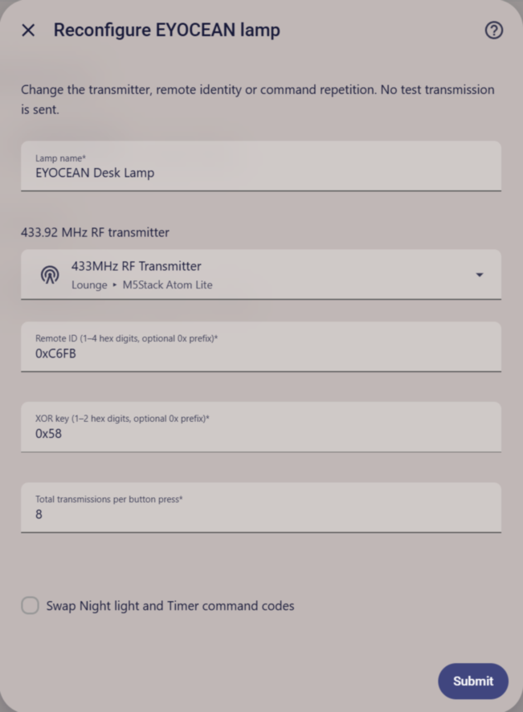

# EYOCEAN RF Desk Lamp for Home Assistant

Control an EYOCEAN desk lamp through Home Assistant's native `radio_frequency` integration. This custom integration works with any registered compatible 433.92 MHz OOK adapter. It does not call ESPHome services or hardcode GPIOs or IP addresses.

Tested against **Home Assistant Core 2026.10.4 and rf-protocols 4.3.0**, without physical RF transmission or lamp-response testing. The native RF APIs are recent; compatibility with other Home Assistant versions needs to be checked separately.

## What it exposes

One device with six stateless buttons:

| Button | Command byte |
|---|---|
| Power toggle | `0x51` |
| Brightness cycle | `0x5B` |
| Color temperature cycle | `0x5A` |
| Reading mode | `0x49` |
| Night light | `0x41` by default |
| Timer | `0x4D` by default |

Enable **Swap Night light and Timer command codes** for variants where those functions are reversed. A remote variant may not support every listed function; disable unsupported button entities in Home Assistant.

The lamp has no feedback channel, and the known commands toggle or cycle its settings. The integration therefore exposes buttons, not a light entity, an absolute brightness slider, or a confirmed on/off state. Button timestamps record requests, not lamp responses. The integration tracks adapter availability and reports transmitter errors to Home Assistant.

## Prerequisites

1. Home Assistant Core **2026.10.4** (the version tested here), with support for the native `radio_frequency` domain.
2. An existing RF transmitter entity supporting **433.92 MHz ASK/OOK**, such as an ESPHome CC1101 RF proxy. Configure its RF hardware, antenna path and TX/RX switching correctly; proxy frequency metadata alone does not tune a radio.
3. A compatible EYOCEAN **32-bit fixed-code** remote. Not all EYOCEAN models are known to use this protocol.
4. The **remote ID** (16 bits) and **XOR key** (8 bits), captured from your own original remote. These are independent per-remote values, not universal model identifiers.

Setup does not scan frequencies, pair a lamp, capture RF, or send a test transmission. Home Assistant 2026.10.4 supports transmitter consumers but lacks the receiver-consumer API on the upstream development branch. Capture your remote ID and XOR key with ESPHome's decoder/logs or a separate capture tool, then enter them during setup.

## Installation

### Install with HACS (recommended)

Install [HACS](https://hacs.xyz/) first, then click the button below to open this integration's repository in your Home Assistant instance:

[](https://my.home-assistant.io/redirect/hacs_repository/?owner=charrus&repository=eyocean-radio-frequency&category=integration)

1. Download **EYOCEAN RF Desk Lamp** in HACS. Enable prerelease versions if the initial release is not listed.
2. Restart Home Assistant.
3. Add your lamp under [Configuration](#configuration).

The button requires [My Home Assistant](https://my.home-assistant.io/) configured with your instance's URL. If you prefer to add the repository manually, go to **HACS → Custom repositories**, add `https://github.com/charrus/eyocean-radio-frequency` with type **Integration**, then download it and restart Home Assistant. This integration is not included in the default HACS catalog.

### Install manually

1. Back up your Home Assistant configuration, including any existing custom `eyocean` integration.
2. Copy the entire `custom_components/eyocean` directory into your Home Assistant configuration directory:

   ```text
   <HA config>/custom_components/eyocean/
     __init__.py
     button.py
     config_flow.py
     const.py
     manifest.json
     protocol.py
     strings.json
     translations/en.json
     UPSTREAM_LICENSE.txt
   ```

   The release ZIP contains the `custom_components/eyocean/` layout and README. Extract it into the HA configuration directory, not inside another `eyocean` subdirectory. The project root's `custom_components/__init__.py` is a test-discovery helper and is not included in the ZIP.
3. Restart Home Assistant when you are ready. The project does not install itself or restart Home Assistant.
4. Add your lamp under [Configuration](#configuration).

## Configuration

After installation and restart, click **Add integration** below. The shortcut requires My Home Assistant configured with your instance's URL.

[](https://my.home-assistant.io/redirect/config_flow_start/?domain=eyocean)

Alternatively, go to **Settings → Devices & services → Add integration → EYOCEAN RF Desk Lamp**.



Choose your RF transmitter and enter a lamp name, remote ID, XOR key and repeat count. Enable the Night/Timer swap if your remote needs it. Have the values listed under [Prerequisites](#prerequisites) ready; installation does not configure the transmitter or capture the remote ID and XOR key.

The remote ID accepts one to four hexadecimal digits; the XOR key accepts one to two. Both allow an optional `0x` prefix. The remote ID cannot be zero; the XOR key can. Do not paste a full 32-bit frame into the remote-ID field. Setup rejects duplicate ID/key pairs, even across different adapters, because each pair identifies the same RF remote command group.

Setup stores a stable transmitter registry reference, so renaming the transmitter entity does not break the integration. Use the integration entry's **Reconfigure** menu to change the adapter, remote ID, XOR key, lamp name, repeat count or Night/Timer assignment. Reconfiguration sends no RF commands. If the transmitter registry entry is missing, reconfigure the integration. If the adapter is offline, buttons remain unavailable until it returns.

The project is licensed under **MIT**; see [LICENSE](LICENSE). Upstream protocol attribution and its MIT notice are retained separately in `custom_components/eyocean/UPSTREAM_LICENSE.txt`.

## ESPHome proxy example

If your device already has `rf_tx`, add this alongside its other top-level components:

```yaml
radio_frequency:
  - platform: ir_rf_proxy
    name: 433MHz RF Transmitter
    frequency: 433.92MHz
    remote_transmitter_id: rf_tx
```

The referenced `remote_transmitter` must have `carrier_duty_percent: 100%`. With CC1101, it must enter TX via `cc1101.begin_tx` before sending and return to RX via `cc1101.begin_rx` on completion. Do not copy generic GPIOs onto the T-Embed. These buttons transmit directly through the proxy. An ESPHome switch that guards a separate lamp-button script **does not block proxy transmissions**.

Do not add a second `radio_frequency:` key if your YAML already has one; merge entries. A transmitter appearing in **Settings → Connectivity → Radio Frequency** should be offered when it declares the matching frequency and modulation.

## Signal and repetition

Published frame structure:

```text
(remote_id << 16) | (command << 8) | (command XOR xor_key)
```

A frame begins `+250, -6250` microseconds, then 32 bits MSB-first: zero=`+250,-750`, one=`+750,-250`. The default is **eight total transmissions**. `rf_protocols.repeat_count` counts additional transmissions, so this integration sets it to **seven**, not eight. The native ESPHome adapter adds one when passing the total to its API.

Repeat count is configurable from 1 to 20. Button requests from all EYOCEAN entries sharing a transmitter registry UUID are sent one at a time, spaced by the encoded burst airtime. Unused transmitter locks are released on unload. This scheduling does not confirm reception or coordinate with unrelated integrations using the same adapter. Observe RF duty-cycle limits and local regulations. The integration does not automatically replay commands or send them at boot or during setup.
