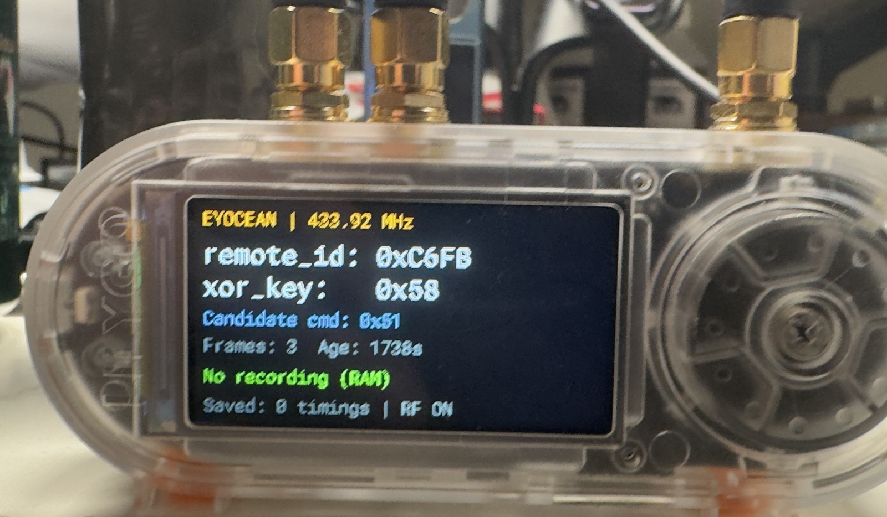

# LILYGO T-Embed CC1101 Plus

Use the built-in CC1101 as a 433.92 MHz ASK/OOK RF proxy for Home Assistant. The [ESPHome configuration](t-embed-cc1101-plus.yaml) displays candidate EYOCEAN remote IDs and XOR keys, provides an IR proxy through the built-in transmitter and receiver, and includes six optional local lamp buttons.

This example uses the **T-Embed CC1101 Plus** pinout, not the original T-Embed pinout. Check your board revision before flashing. SD and nRF24L01 stay inactive. NFC, charger control, rotary controls and raw recording/replay are not configured.

## Setup

1. Copy [t-embed-cc1101-plus.yaml](t-embed-cc1101-plus.yaml) into your ESPHome configuration directory. It requires ESPHome **2026.10.1** or later.
2. Set `name` and `friendly_name`. Leave `remote_id` and `xor_key` at zero if you only want to capture a remote or use the Home Assistant integration.
3. Add these entries to your private `secrets.yaml` alongside the copied configuration:

   ```yaml
   api_key: "<device-specific base64 API encryption key>"
   wifi_ssid: "<your Wi-Fi SSID>"
   wifi_password: "<your Wi-Fi password>"
   ```

   Generate the API key with `openssl rand -base64 32`. Keep secrets out of version control.
4. Validate, compile and flash through ESPHome. With the CLI:

   ```sh
   esphome config t-embed-cc1101-plus.yaml
   esphome run t-embed-cc1101-plus.yaml
   esphome logs t-embed-cc1101-plus.yaml
   ```

   The display uses Roboto Mono from Google Fonts. Validation and compilation need network access unless the font is already cached.
5. Add the device through Home Assistant's ESPHome integration. It exposes **433MHz RF Transmitter**, **433MHz RF Receiver**, **IR Transmitter** and **IR Receiver**, plus the backlight, decoded identity sensors and local lamp controls.

## Display and remote capture



The photo includes recording features that are not in this example. The example shows **RF control: ON/OFF**, without the **No recording (RAW)** or **Saved: 0 timings** lines.

After boot, the example displays **Waiting for RF decode**. Press a button on your original lamp remote, then read:

| Display field | Meaning |
|---|---|
| `remote_id` | Candidate 16-bit remote ID; `0xC6FB` in the photo |
| `xor_key` | Candidate 8-bit XOR key; `0x58` in the photo |
| `Candidate cmd` | Last recognized command; `0x51` means power toggle |
| `Frames` | Accepted candidate frames since boot, including repeats |
| `Age` | Seconds since the latest candidate frame, not lamp status |
| `RF control` | State of the switch guarding the optional local lamp buttons |

The photo's values are examples, not settings for every lamp. Press several different remote buttons and check that the ID/key pair stays the same while the command changes. Candidates also appear in the ESPHome logs at INFO level:

```text
Candidate frame=0xC6FB5109 remote_id=0xC6FB xor_key=0x58 command=0x51
```

The decoder checks pulse timing and known command bytes, but does not authenticate the remote or confirm a lamp response. Each candidate replaces the displayed identity, so nearby compatible remotes can change it. Candidate values and frame counts reset on reboot. They never change the identity used to transmit commands.

## Home Assistant integration

Add **EYOCEAN RF Desk Lamp**, select this device's **433MHz RF Transmitter**, and enter the remote ID and XOR key captured from your own remote. Follow the [integration configuration instructions](../README.md#configuration). Do not enter the full 32-bit `frame` as the remote ID.

Integration buttons use the identity entered in Home Assistant. They do not use the YAML's `remote_id` and `xor_key` substitutions and do not require **Allow RF control** to be on.

## Optional local lamp buttons

ESPHome provides its own **Power toggle**, **Brightness cycle**, **Color temperature cycle**, **Reading mode**, **Night light** and **Timer** buttons, separate from the integration's buttons. To use them:

1. Set the YAML's `remote_id` and `xor_key` substitutions to your captured values, keeping them quoted, then compile and flash again. A zero remote ID blocks these buttons; a zero XOR key is allowed.
2. If your remote reverses Night light and Timer, exchange `cmd_night_light` and `cmd_timer`. The Home Assistant integration has its own independent swap setting.
3. Turn on **Allow RF control** in Home Assistant, then press a local lamp button. The switch resets to off on every boot.

These buttons send eight copies of each command and do not report lamp state. **Allow RF control** only blocks these local lamp buttons, not RF or IR proxy transmissions. No lamp command is sent at boot.

## Hardware mapping

| Function | GPIOs / configuration |
|---|---|
| Shared SPI | Clock 11, MOSI 9, MISO 10 |
| CC1101 | CS 12, RX data 38, TX data 3; 433.92 MHz ASK/OOK |
| Antenna path | Switch outputs 47 and 48 both high at boot |
| Board power enable | GPIO15 high at boot |
| Display | ST7789V, CS 41, DC 16, backlight 21; rotation 270 |
| Inactive peripherals | SD CS 13 high, nRF CS 44 high, nRF CE 43 low |
| Infrared | RX 1, TX 2 |

The transmitter enters CC1101 TX mode before sending and returns to RX when finished. Keep these callbacks if you change the YAML. The `cc1101` component sets the radio's frequency and modulation; the proxy's frequency metadata does not configure the hardware.

## Troubleshooting

- **No candidate:** check the 433 MHz antenna connection, board revision and remote compatibility. Set `logger.level: DEBUG` to inspect raw pulse dumps; candidate messages use INFO.
- **Local button blocked:** configure a nonzero remote ID and turn on **Allow RF control** after boot. This does not affect integration buttons using the proxy.
- **Lamp does not react:** verify the captured ID/key pair, antenna path and command mapping. Successful transmission requests do not confirm a lamp response.
- **Blank display or boot problems:** verify the Plus pinout and configured flash/PSRAM settings. Review build and device logs before changing pins.
- **Transmitter missing in setup:** confirm the ESPHome device is connected and exposes its RF transmitter, then check the [integration prerequisites](../README.md#prerequisites).
